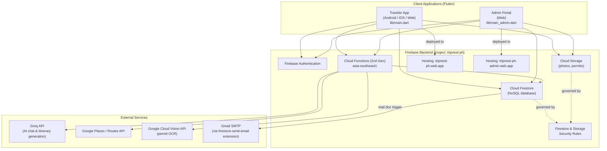
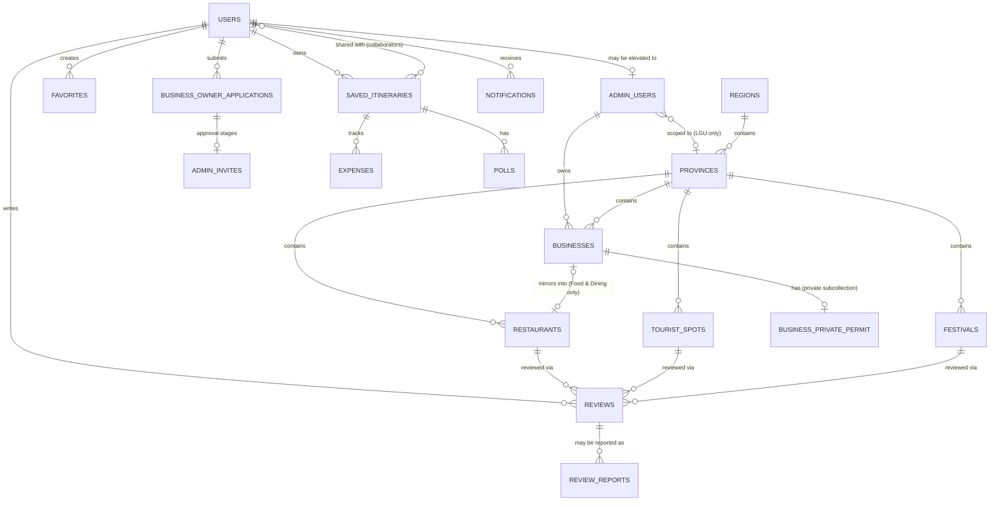
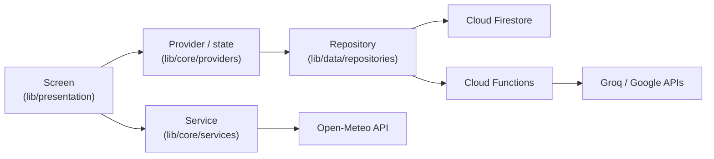

# TripNest PH — Project Documentation

## 1. Project Title and Description

**Project Title:** TripNest PH: AI-Powered Local Tourism Discovery Application

**Description:**
TripNest PH is an AI-powered tourism platform that helps travelers discover
destinations, plan personalized trips, and explore local businesses across
the Philippines. It combines a curated content library (tourist spots,
restaurants, festivals, travel tips) with an AI trip-planning assistant, and
gives local business owners, Local Government Unit (LGU) accounts, and
platform administrators dedicated tools to manage listings, moderate
content, and review business applications.

The system is built as a single Flutter codebase with **two separate
entrypoints**: a traveler-facing app (Android, iOS, Web) and a dedicated
**Admin Portal** web app for administrators, LGU accounts, and business
owners — sharing the same backend (Firebase) but shipping as two
independently-built web bundles so the admin bundle never includes
traveler-only code, and vice versa.

---

## 2. Project Objectives

### General Objective
To design and develop an AI-assisted tourism platform that makes trip
planning across the Philippines more personalized and convenient for
travelers, while giving local businesses, LGUs, and administrators the
tools to manage tourism-related content and listings efficiently and
securely.

### Specific Objectives
1. To provide travelers with a searchable, filterable directory of tourist
   destinations, restaurants, accommodations, and festivals organized by
   Philippine region and province.
2. To generate personalized AI-assisted itineraries based on a traveler's
   budget, interests, trip duration, pace, and real-time weather/route
   data, and to support refining an itinerary through natural-language chat.
3. To support collaborative trip planning through shareable itineraries,
   group polls for group decisions, and shared expense/budget tracking.
4. To let local business owners self-register, list their own businesses,
   and submit proof-of-business documentation (a permit photo) for admin
   review — with OCR-assisted text extraction to speed up that review.
5. To give administrators and LGU accounts a dedicated Admin Portal for
   content moderation, business/application approval, and analytics,
   scoped by role (platform-wide admin vs. province-scoped LGU).
6. To implement secure, role-based authentication — including a custom
   numeric one-time-code (OTP) flow for password reset and email
   verification — across traveler, business owner, LGU, and admin roles.
7. To protect user and business data through Firebase Security Rules,
   least-privilege access design, and defense-in-depth safeguards against
   common data-exposure and abuse scenarios.

---

## 3. Scope and Limitations

### Scope
- Cross-platform traveler app (Android, iOS, Web) and a separate Admin
  Portal web app, sharing one Firebase backend.
- Browsable, filterable content: tourist spots, restaurants, festivals,
  travel tips, and local-business listings, organized by region/province.
- AI itinerary generation and an AI travel chat assistant (Groq-hosted
  LLM), grounded in the app's own destination/culture data.
- Trip collaboration: shared itineraries (via share code), group polls,
  shared packing lists, and a per-trip expense tracker.
- Reviews and ratings, favorites and named favorite collections, and
  traveler-submitted content/review reports for moderation.
- A self-service Business Owner flow: sign-up role choice → application →
  admin approval → invite acceptance → business listing management,
  including permit photo upload with automatic OCR text extraction
  (Google Cloud Vision) to assist admin review.
- Role-based Admin Portal (`admin`, `lgu`, `businessOwner` roles) with
  approval queues, content management, and analytics dashboards — LGU
  accounts scoped to a single assigned province.
- Custom numeric OTP-based password reset and email verification
  (replacing Firebase's default link-based emails), delivered through a
  branded HTML email template.

### Limitations
- **OCR is a reading aid, not verification.** The Cloud Vision-based text
  extraction on an uploaded business permit only transcribes whatever text
  is in the photo — it cannot confirm the document is genuine, current, or
  belongs to the applicant. Final approval is always a manual admin
  judgment call; the OCR text is explicitly labeled "verify against the
  actual photo" in the Admin Portal.
- **AI output is an estimate, not a guarantee.** Itinerary suggestions and
  budget figures come from an LLM (Groq) and are disclosed to users as
  AI-generated estimates, not confirmed pricing or availability.
- **Philippines-only scope.** Region/province data and localization are
  specific to the Philippines.
- **Third-party API dependency.** Weather, routing, place search, and OCR
  features depend on the availability of Google's Places, Routes, Weather,
  and Vision APIs, and the AI chat/itinerary features depend on Groq's API.
- **Mostly online.** The system requires an internet connection for nearly
  all functionality. The only offline support is for saved trips, whose
  places and photos are cached so an already-saved itinerary can still be
  opened without a connection.
- **Curated, not crowdsourced, base content.** Tourist spots and festivals
  are authored by admin/LGU accounts, not submitted directly by travelers
  (only business listings are self-service).

---

## 4. System Architecture

### Layer summary
- **Traveler App / Admin Portal** — one Flutter codebase, two entrypoints
  (`lib/main.dart`, `lib/main_admin.dart`) and two `go_router` route trees,
  so the Admin Portal bundle never ships traveler-only screens or vice
  versa. Both are built and deployed as separate Firebase Hosting sites.
- **Firebase Authentication** — email/password and Google sign-in; a
  traveler's Auth `uid` doubles as their `users/{uid}` and, when granted a
  role, `admin_users/{uid}` document key.
- **Cloud Firestore** — the primary database (see Section 5).
- **Cloud Storage** — hero photos, review photos, and business permit
  photos, gated by `storage.rules` (owner/admin-only for permits).
- **Cloud Functions** — server-side logic that must run with elevated
  trust or a hidden API key: AI chat/itinerary calls (Groq), Places/Routes
  proxying, permit OCR (Vision), OTP email codes, admin-claim syncing, and
  scheduled analytics snapshots.
- **External APIs** — Groq (LLM), Google Places/Routes/Vision, and Gmail
  SMTP (through the `firestore-send-email` Firebase Extension, triggered
  by writes to the `mail` collection).

---

## 5. Database Design

Cloud Firestore is a NoSQL, document-based database — collections don't
enforce a rigid schema the way SQL tables do, and relationships are
maintained by storing a related document's ID (and often a denormalized
display value) rather than foreign keys. The diagram below shows those
relationships as an entity-relationship-style model for readability.

### Collection Reference

| Collection (path) | Purpose | Key fields | Notes |
|---|---|---|---|
| `users/{uid}` | Traveler profile | `name`, `email`, `photoUrl`, `travelPreferences[]`, `favoriteCategories[]`, `emailVerified`, `status` | `status` (`active`/`suspended`) is admin-managed only |
| `users/{uid}/recently_viewed/{destinationId}` | Recently-viewed content, per traveler | — | Subcollection |
| `users/{uid}/visited/{visitId}` | Places a traveler has marked visited | — | Backs the "Verified Visit" review badge |
| `admin_users/{uid}` | Admin Portal account (elevates a traveler's own `uid`) | `role` (`admin`\|`lgu`\|`businessOwner`), `status`, `provinceId`, `provinceName`, `businessName` | `provinceId` set only for `lgu` — scopes their whole portal |
| `admin_invites/{email}` | Staged role grant awaiting acceptance | `role`, `status` | Accepted from the traveler's own Profile screen |
| `tourist_spots/{spotId}` | Curated tourist attractions | province/region link, category, description, photos | Admin/LGU-authored |
| `restaurants/{restaurantId}` | Restaurant/dining listings | cuisine, price range, opening hours, rating aggregate | Either admin-authored or mirrored from an approved `businesses` Food & Dining listing |
| `festivals/{festivalId}` | Local events/festivals | date, province, description, photos | Admin/LGU-authored |
| `travel_tips/{tipId}` | General travel advice content | category, body text | Admin-authored |
| `regions/{regionId}` | Philippine region reference data | name | Top of the region → province hierarchy |
| `provinces/{provinceId}` | Province reference data | `regionId`, name, `localTransport` | |
| `provinces/{provinceId}/cities/{cityId}` | City reference data | name | Subcollection |
| `favorites/{favoriteId}` | A traveler's saved item | `userId`, item type/id | |
| `favorite_collections/{collectionId}` | Named groups of favorites | `userId`, name, item ids | |
| `saved_itineraries/{itineraryId}` | A saved/generated trip plan | `userId`, `title`, `itinerary` (days/activities), `collaboratorIds[]`, `memberNames`, `packingItems`, `startDate` | Shareable via a share code; collaborators can edit expenses/packing, not the itinerary itself |
| `saved_itineraries/{id}/expenses/{expenseId}` | Shared trip expense line items | amount, payer, category | Subcollection |
| `saved_itineraries/{id}/polls/{pollId}` | Group decision polls for a trip | question, options, votes | Subcollection |
| `businesses/{businessId}` | A business owner's self-service listing | `ownerId`, `name`, `category`, `description`, `provinceId`, `heroImageUrl`, `status` (`pending`\|`approved`\|`rejected`\|`suspended`), `restaurantId`, `viewCount` | Public fields only — **never** the permit photo/OCR text (see below) |
| `businesses/{id}/private/permit` | The uploaded permit photo URL and its OCR'd text | `permitUrl`, `permitOcrText` | Deliberately split from the parent doc — readable only by the owner and an admin, never by travelers, since a permit can contain real PII. `permitOcrText` is written only by the `extractPermitText` Cloud Function, never by the client |
| `business_owner_applications/{id}` | A traveler's request to become a Business Owner | `userId`, `applicantName`, `businessName`, `category`, `status` (`pending`\|`approved`\|`rejected`), `rejectionReason` | Approval stages an `admin_invites` entry rather than granting the role directly |
| `analytics_snapshots/{date}` | Daily platform-wide stats | traveler/business/report counts | Written only by a scheduled Cloud Function |
| `reviews/{reviewId}` | Ratings/comments on a listing | `userId`, `targetId`, `targetType`, `rating`, `comment`, `verified` | `verified` requires a matching `visited` record |
| `review_reports/{reportId}` | A flagged review, for moderation | reporter, reviewId, reason | |
| `content_reports/{reportId}` | A flagged listing itself | reporter, target, reason | |
| `notifications/{notificationId}` | In-app notifications | recipient, title, body, category, `readBy[]` | Some are broadcast (shared `readBy` array) |
| `rate_limits/{id}` | Rolling-window abuse-prevention counters | `timestamps[]` | Internal use by Cloud Functions only |
| `otp_codes/{id}` | Numeric codes for password reset / email verification | code hash, expiry | Not client-readable at all |
| `mail/{id}` | Outbound email queue | to, message (HTML) | Consumed by the `firestore-send-email` extension |
| `search_trends/{term}` | Aggregated search term popularity | term, count | Powers admin analytics |

---

## 6. Project Progress Report (Current Accomplishments)

### Core Traveler Experience
- Destination/restaurant/festival discovery with Search, Explore, and
  Nearby, including budget, distance, and accessibility-tag filters.
- Destination details with live current-weather, map, directions, and an
  Emergency panel.
- Reviews & ratings with a "Verified Visit" badge, restaurant-owner reply,
  and traveler-side reporting for both reviews and listings.
- Favorites, plus the ability to group favorites into named collections.
- A responsive web/desktop layout for the traveler-facing core.

### AI Trip Planning
- AI Itinerary Planner generating multi-day plans from budget, interests,
  trip duration, and a trip-pace selector, grounded in real weather and
  road-following route data (Google Routes API) for every day of the trip.
- "Refine with AI" — chat-driven edits to an already-generated itinerary.
- An AI Travel Assistant chat, grounded in the app's own destination/
  culture data, with inline place cards and headed comparison answers.
- AI-generated restaurant review digests ("Travelers say").
- A starter packing checklist generated from the trip's real weather
  forecast; manual add/remove/reorder of itinerary activities.

### Trip Collaboration
- Shareable saved itineraries with collaborator access.
- A shared Budget Tracker with priced example line items across Food,
  Accommodation, Entrance Fees, and Transportation, editable by the trip
  owner, with a disclaimer that AI-estimated prices are approximations.
- Group Trip Polls for collaborative decisions, with a validation/
  confirmation audit pass to close reported gaps.

### Business Directory & Business Owner Flow
- Self-service Business Owner sign-up: a role-choice modal on Sign Up →
  application form → admin approval (stages an invite) → invite
  acceptance from Profile.
- Business listing management ("My Business") — create, edit, and
  resubmit-after-rejection, with required-field validation (name,
  description, address, contact number, province, hero photo, and
  category-specific fields for Food & Dining).
- **Business Permit upload with automatic OCR**: an owner-uploaded permit
  photo is automatically read via Google Cloud Vision immediately after a
  successful submission, so the admin sees extracted text alongside the
  photo during review — explicitly labeled as a reading aid, not a
  verification signal.
- **Security hardening of the permit/OCR feature**: the permit photo URL
  and its OCR text were split out of the publicly-readable `businesses`
  document into an owner/admin-only private subcollection (closing a data
  exposure gap), and `permitOcrText` was made writable only by the Cloud
  Function itself — a client can never fabricate OCR output that Vision
  never actually produced.
- Admin Business list: approve (with a no-permit warning), reject/suspend
  with a required reason shown to the owner, reactivate, and delete —
  including keeping a Food & Dining listing's mirrored `restaurants` doc
  and its reviews/favorites in sync.

### Authentication & Accounts
- Custom **numeric OTP** password-reset and email-verification flow
  (replacing Firebase's default link-based emails, which were landing in
  spam), with a branded HTML email template and rate-limited Cloud
  Functions.
- A redesigned desktop split-layout Login/Register experience.
- Membership gating extended to Add Expense/Add Item flows.

### Admin Portal
- A dedicated Admin Portal web app (separate entrypoint, router, and
  Hosting site) with zero traveler-facing code in its bundle.
- A desktop sidebar shell with branding and an admin profile footer.
- Role-scoped access: `admin` (platform-wide), `lgu` (single assigned
  province), and `businessOwner` (their own listing only).
- Content management for tourist spots, festivals, and travel tips.
- Moderation queues for reported reviews/content and business owner
  applications.
- An analytics dashboard, including a traveler-growth trend chart, scoped
  appropriately for LGU accounts (no platform-wide numbers).

### Platform & Security Hardening
- Firestore/Storage Security Rules hardened repeatedly alongside feature
  work — per-user rate limiting, signed photo tokens, defense-in-depth
  validation helpers, and the permit/OCR privacy fix described above.
- Cloud Functions upgraded to Node 22 / firebase-functions v7 /
  firebase-admin v14.
- Fixed a range of correctness bugs across itinerary sharing/regenerate/
  packing races, review aggregate races, Explore/Search/Nearby request
  races, account deletion gaps, and admin suspension lag.

### Navigation, Connectivity & Usability (September–October 2026)
- A manual itinerary builder, so a traveler can plan a trip by hand
  instead of generating it with AI.
- Festival and trip reminders through local notifications, with past
  reminder times rejected.
- An app-wide internet connection notice: a "No internet connection" /
  "Back online" message shown on every screen when the status changes.
- Saved trips stay usable offline (their places and photos are cached).
- Swipe navigation between tabs on Explore and the destination picker.
- Consistent, safe Back navigation across the traveler app and the Admin
  Portal (falls back to a sensible screen when there is nothing to pop).
- User-friendly error messages everywhere, with raw technical errors no
  longer shown to the user.
- Responsive layout and overflow fixes across phone, tablet and desktop
  screen sizes.

---

## 7. Setup and Installation

Full instructions are in the project [README](../README.md). In short:

1. Install Flutter 3.44 or newer and an Android device or emulator.
2. Run `flutter pub get`.
3. Run `flutter run` for the traveler app, or
   `flutter run -d chrome -t lib/main_admin.dart` for the Admin Portal.
4. Build an installable APK with `flutter build apk --release`.

The Firebase configuration for the `tripnest-ph` project is included in
the repository, so no extra backend setup is needed to run the app.

## 8. Data Flow

Every screen follows the same path for reading and writing data:

- **Screens never talk to Firestore directly.** Each collection has one
  repository class that owns all of its reads and writes.
- **Reads** are either one-time (`get`) or live (`snapshots`), so lists
  such as My Trips update on screen as soon as the data changes.
- **Writes** are checked twice: form validation in the app, then
  Firestore Security Rules on the server.
- **Calls that need a secret API key** (AI, Places, Routes, OCR) go
  through Cloud Functions, so keys are never shipped in the app.
- **Errors** are converted to user-friendly messages before they reach
  the screen.

See [API_Documentation.html](API_Documentation.html) for the external
APIs and [CRUD_Documentation.md](CRUD_Documentation.md) for the
create, read, update and delete operations.

---

*This document reflects the state of the TripNest PH codebase as of
October 2026.*
